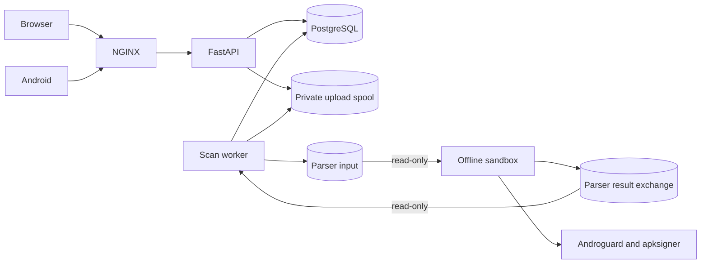

# Architecture

FastAPI authenticates users and streams raw APK bodies into owner-scoped queue entries. SHA-256 and active deduplication happen before queue insertion. A database write lock serializes admission and claims across API and worker processes. Complete archive validation happens in the offline parser. Terminal state and the report are committed in one database transaction. A worker lease recovery pass marks expired work failed. A cleanup pass deletes terminal and orphaned blobs, expired reports, and expired sessions.

The broker passes an APK through an input volume to a parser container without database credentials or network access. Parser output is bounded and transferred through a separate volume. The worker combines parser facts, current catalog records, versioned rules, and optional checksum-pinned artifacts to write the report. The dashboard, comparison views, and PDF and JSON exports read that report snapshot.

SQLAlchemy Core supplies cross-dialect queries. The explicit migration runner manages an initial schema and a sequenced upgrade, with PostgreSQL advisory locking or a SQLite immediate transaction. The scan row stores versioned bounded JSON evidence and indexed owner, creation time, hash and state. The catalog has independently versioned records and append-only revisions through the admin API.

Reports carry a schema version, rule version, tool details, independent authenticity results, model availability, evidence, and coverage. Archive findings tie to specific manifest fields or DEX references. Exact APK hash matches in a reviewed threat snapshot take precedence. Verified signer mismatch or a rejected signature yields high risk. Medium findings, possible impersonation, or a model threshold crossing yield moderate risk. Incomplete signing or DEX coverage without stronger evidence is inconclusive. Otherwise the assessment is low observed risk.

Active duplicates reuse the existing job for the same owner. Completed hashes can be scanned again to reflect catalog revisions, artifact changes, and parser changes.
